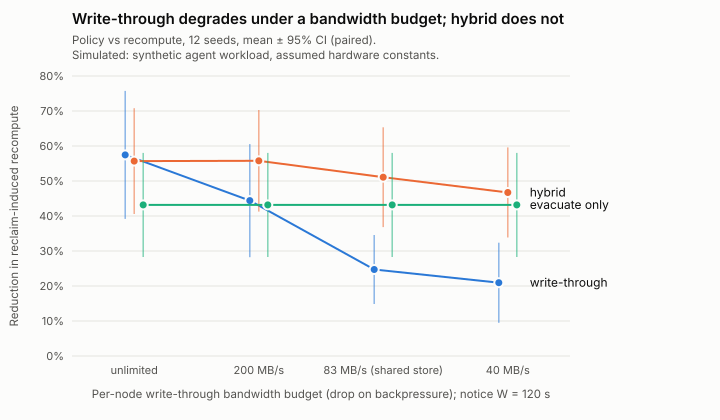

# spot-resilient-serving

**Spending the spot notice: deadline-bounded evacuation of agent-session KV caches.**

Agentic LLM workloads keep tens of thousands of tokens of KV cache per session alive
*between* turns. When a spot GPU node is reclaimed, that cache disappears silently: no
request fails, but every later turn of every resident session pays a full re-prefill.
Existing fault-tolerance systems protect in-flight requests, and agent-KV systems protect
idle sessions only against eviction on a live node.

This project treats the cloud's termination notice as a budget. A planner decides which
session caches to save, and where, under a deadline, bandwidth limits and failure
domains. An out-of-tree vLLM plugin carries the plan out on real GPUs.

- Paper draft: [docs/paper/draft.md](docs/paper/draft.md), LaTeX in
  [docs/paper/main.tex](docs/paper/main.tex), compiled [main.pdf](docs/paper/main.pdf).
- Every number below is marked **(S)** simulated, **(C)** simulated with constants
  measured on hardware, or **(M)** measured on real hardware.

## Findings

What holds up:
- **Most of a node's KV is idle.** Replaying 393 real coding-agent sessions (the
  SemiAnalysis AgentX Claude Code trace), 75–78% of a large node's resident KV belongs to
  sessions with no turn in flight (S).
- **Evacuation on notice pays.** It recovers 47–52% of reclaim-induced recompute at a
  2-minute notice with zero steady-state cost, within 5–10 points of continuous
  replication (C). At equal memory, evacuation still recovers about half while
  write-through replication does worse than doing nothing (S).
- **The notice is long enough.** One real EC2 spot interruption announced 118 s, and the
  instance kept running for at least 97 s after it (M). The vLLM plugin moved 10.2 GB of
  session KV from an L40S node to a memory node's DRAM over NFS in 6.6 s (M).
- **Restore is correct.** Restored sessions produce greedy output identical to cold
  recompute, apart from one exact floating-point logit tie (M).

Where it is weaker:
- **Restore vs recompute is a crossover.** For Llama-3.1-8B on an L40S they are at parity
  (8.3 s vs 9.1 s TTFT at 59k tokens, 2.9 s vs 2.4 s at 22k; single runs) (M). A 24B 4-bit
  model on an L4 restored 2.8–3.7× faster than recompute (M), but model size, GPU and
  quantization changed at once, so that gain cannot be credited to model size alone.
- **Ordering matters little.** On hardware, the planner did no better than
  most-recent, largest-first or random orders (all within 95% CIs, 10 snapshots) (M). An
  offline model over 148 snapshots favours the planner over recent and random orders
  and ties it with largest-first (C); its intervals are probably too narrow.
- **Predicting which sessions return is the open problem.** A learned return predictor
  reaches AUC 0.79 (recency: 0.59) but closes only about a fifth of the gap to an oracle,
  not significantly (C).

Limitations: the spot notice was measured on a CPU spot instance because spot GPU capacity
was never available (notice timing is an EC2 property, not a GPU one); the "peer" was a
CPU memory node serving RAM over NFS, not a surviving GPU server; most hardware results
are single runs.



## Documents

| Doc | Contents |
|---|---|
| [step0-recon.md](docs/step0-recon.md) | What vLLM does on preemption today, at a pinned commit |
| [sota-2026.md](docs/sota-2026.md), [positioning.md](docs/positioning.md) | Related work and novelty check (Oct 2026) |
| [simulator.md](docs/simulator.md) | Cost model, planner and discrete-event simulator |
| [phase1b-results.md](docs/phase1b-results.md) | Contention, hybrid policy, backpressure, equal memory (S) |
| [phase1c-results.md](docs/phase1c-results.md) | Related-work baselines and value at risk on the real trace (S) |
| [calibration.md](docs/calibration.md), [phase2-results.md](docs/phase2-results.md) | L40S calibration and the spot-notice measurement (M, C) |
| [phase3-design.md](docs/phase3-design.md), [phase3-results.md](docs/phase3-results.md) | vLLM plugin design and GPU results, including the planner sweep (M) |
| [returnpred-results.md](docs/returnpred-results.md) | Learned return prediction (C) |

## Quick start (CPU only)

```bash
uv venv -p 3.13 .venv && uv pip install -p .venv/bin/python -e ".[dev]"
.venv/bin/python -m pytest
.venv/bin/python -m kvevac.experiments all --seeds 6 --out results/phase1b
```

Real-trace experiments need the AgentX trace
([huggingface.co/datasets/semianalysisai/cc-traces-weka-062126-256k](https://huggingface.co/datasets/semianalysisai/cc-traces-weka-062126-256k),
Apache-2.0) saved as `data/raw/agentx.jsonl` (git-ignored). The commands are in each
results doc.

GPU runs use AWS. [jobs/README.md](jobs/README.md) describes the one-file CloudShell runner
(`jobs/aws/kvevac-aws.sh`), the two-node and planner-sweep jobs, the IAM policy they need,
and the cost of each run. Every instance shuts itself down on a timer.

## Layout

```
kvevac/profiles.py        model / GPU / link constants
kvevac/costmodel.py       recompute vs transfer time, crossover
kvevac/planner.py         deadline-bounded evacuation knapsack (the core decision)
kvevac/flush.py           session plan -> prefix-ordered, deduplicated block flush order
kvevac/reuse.py           session reuse estimators (fixed / recency / oracle)
kvevac/returnpred.py      learned return predictor
kvevac/workload.py        agent sessions (synthetic, AgentX-calibrated) + real-trace loader
kvevac/sim.py             discrete-event fleet simulation
kvevac/experiments.py     experiments with paired 95% CIs (--calibration aware)
kvevac/calibration.py     fit cost-model constants from measurements
kvevac/characterize.py    value at risk per node: hot/idle KV, rebuild cost, rho
kvevac/measure/           prefill, interference and notice-timing measurement clients
kvevac/notice/            IMDSv2 mock, spot-notice watcher and handler
kvevac/vllm_plugin/       deadline write-back for vLLM's tiered KV offload
jobs/aws/                 AWS runners (single node, two node, planner sweep) and dry runs
results/                  every result the docs and paper cite
scripts/figures.py        SVG figures from results JSON
```

## What this project does not claim

No dynamic reparallelization (SpotServe). No better reuse predictor (CacheScout,
Continuum, CacheWise); the estimator is pluggable. Not the first to predict preemption
(Parcae, hazardserve) or to exploit its correlation (SkyServe). Not that KV transfer
generally beats recompute; ShuntServe measured the opposite at short contexts, and the
8B results here agree.

## License

MIT, see [LICENSE](LICENSE).
