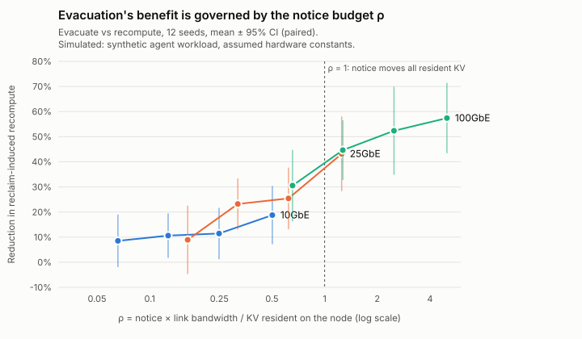
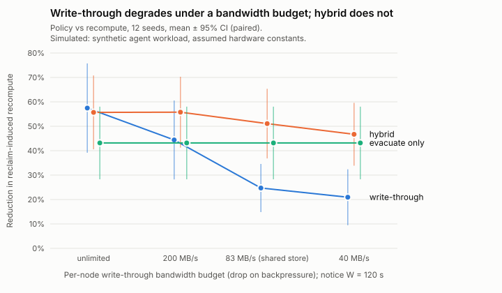

# Phase 1b results (simulated; 20 seeds for the main map, 12 elsewhere)

**Status of these numbers:** discrete-event simulation. The workload is synthetic
agent sessions fitted to the published AgentX marginals. Hardware constants are
assumed (`kvevac/profiles.py`). Every policy within a seed sees the same workload
and reclaim schedule, so comparisons are **paired**: Δ is the mean per-seed
difference against `recompute`, ± its 95% t-interval over 12 seeds. Tables and JSON
are in `results/phase1b/`. Reproduce with:

```bash
python -m kvevac.experiments all --seeds 12 --out results/phase1b
python scripts/figures.py   # regenerates docs/figures/*.svg from the JSON
```

Default: 12 nodes in 3 failure groups, 4M-token session cache per node, 800 sessions
(≈36% prefill utilization), Llama-3.1-8B on L40S, 25GbE, independent reclaims at
0.1 per node-hour. Write-through (`replicate`) gets a **separate 4M-token replica
tier and unlimited replication bandwidth** unless stated otherwise. Those are
generous assumptions, and §3–4 relax them. Metric: **excess prefill GPU-seconds**
against a no-reclaim run.

## Headline

1. **Under generous assumptions, write-through is strong and the hybrid is best.**
   With a free full-size replica tier and unlimited bandwidth, write-through cuts
   reclaim-induced recompute by 51–59% at any notice. Hybrid (write-through plus
   write-back at notice) matches it (−56% to −61%) and also protects in-flight
   turns: 1–5 killed vs 20–27. Evacuation alone gets −14% to −43%.
2. **At equal memory, evacuation wins decisively.** If the replica tier's memory is
   used as primary cache instead, recompute-plus-evacuation beats write-through by a
   wide margin (§3). Halving the primary cache to hold replicas costs more misses
   than replication saves.
3. **Under a realistic shared-store bandwidth budget, write-through degrades and
   evacuation does not** (§4). Hybrid stays robust.
4. **Evacuation's benefit is governed by ρ = W·B / resident KV** (§2).
5. **Reuse prediction is the main lever left for evacuation** (§5).

## 1. Main regime map (`results/phase1b/main.md`, 20 seeds)

Δ% vs `recompute` (± 95% CI as a share of the recompute mean), independent /
correlated (half a failure group per burst):

| notice W | evacuate | replicate (write-through) | hybrid |
|---|---|---|---|
| 0 s | 0 / 0 | −53% ±13 / −57% ±10 | −53% ±13 / −57% ±10 |
| 30 s | −20% ±10 / −16% ±4 | −55% ±16 / −59% ±9 | −58% ±16 / −59% ±9 |
| 120 s | −42% ±12 / −43% ±10 | −59% ±13 / −61% ±10 | −56% ±12 / −61% ±10 |

Killed in-flight turns at W=120 s (independent): recompute 22.2, write-through
23.6, evacuate 1.4, hybrid 1.2. Draining alone (not shown; see the table file) is
never significantly better than doing nothing. Other experiments in this doc use 12
seeds.

## 2. The governing ratio (`results/phase1b/budget.md`)



| link | W=15 s | 30 s | 60 s | 120 s |
|---|---|---|---|---|
| 10GbE (ρ ≈ 0.05–0.40) | −9% | −11% | −11% | −19% |
| 25GbE (ρ ≈ 0.13–1.0) | −9% | −23% | −25% | −43% |
| 100GbE (ρ ≈ 0.5–4.0) | −31% | −45% | −52% | −57% |

The benefit is close to monotone in ρ and saturates above about 1. Operators can
compute ρ from their notice window, NIC, and cache size to decide whether evacuation
is worth deploying. Shipping partial prefixes to use leftover notice time adds only
0–5 points (`partial.md`; not significant).

## 3. Equal memory (`results/phase1b/equal_memory.md`)

8M tokens per node, either as an 8M primary cache (recompute, evacuate) or as a 4M
primary plus 4M replica tier (replicate, hybrid). All rows are measured against the
same baseline: the 8M primary fleet with no reclaims.

| | W=30 s ind / corr | W=120 s ind / corr |
|---|---|---|
| evacuate (8M primary) | −19% / −13% | **−50% / −46%** |
| replicate (4M + 4M) | +90% / +94% | +94% / +84% |
| hybrid (4M + 4M) | +91% / +88% | +96% / +83% |

**Caveat:** this holds when the replica tier is the same scarce memory (host DRAM
or HBM) as the primary cache. If replicas live on cheap capacity (local SSD, an
object store), capacity is no longer the constraint; bandwidth (§4) and restore
latency are. Restore latency from a remote store is not modelled for write-through,
which flatters it.

## 4. Write-through under a bandwidth budget (`results/phase1b/backpressure.md`)



A per-node replication budget with drop-on-backpressure, in the shape of vLLM's
`ThrottledDropPolicy`. W = 120 s.

| replication budget per node | replicate | hybrid | evacuate |
|---|---|---|---|
| unlimited | −57% | −56% | −43% |
| 200 MB/s | −44% | −56% | −43% |
| **83 MB/s** (one ~1 GB/s store shared by 12 nodes) | **−25%** | **−51%** | −43% |
| 40 MB/s | −21% | −47% | −43% |

Unconstrained write-through needs about 70–85 MB/s per node on average, but its
bursts exceed that, so even a 200 MB/s budget drops updates. **With a shared store,
evacuation alone beats write-through. Hybrid is robust because evacuation fills
exactly the gaps that dropped writes leave.**

### 4b. Replicas on an object store (`results/phase1b/remote_replica.md`)

This is closest to vLLM's write-through to its object-store tier (`tiering/obj`). It
uses no DRAM for replicas, but each failover must fetch the replica back (0.8 GB/s
assumed).

| replication budget | W | replicate | hybrid | evacuate |
|---|---|---|---|---|
| unlimited | 30 s | −58% | −59% | −23% |
| unlimited | 120 s | −60% | −57% | −43% |
| 83 MB/s | 30 s | −32% | −48% | −23% |
| 83 MB/s | 120 s | −32% | −50% | −43% |

Restore latency barely matters: agent sessions usually idle long enough for the
fetch to finish before the next turn. **Write bandwidth is what binds.** With a
realistic shared budget, hybrid beats write-through by about 16–18 points.

### 4c. Receiver-side interference (`results/phase1b/interference.md`)

The destination's prefill slows by a factor while evacuated KV is arriving (PCIe,
NIC, and host-memory contention). The extra GPU time counts as excess. W = 120 s.

| receiver slowdown while ingesting | 0% | 25% | 50% | 100% |
|---|---|---|---|---|
| evacuate | −43% | −39% | −25% | −22% |
| hybrid | −56% | −52% | −49% | −48% |

Evacuation alone is sensitive to this, and hybrid is robust because it moves less at
notice. **Phase 2 must measure receiver slowdown under real KV ingestion.** It is now
the assumption that most affects evacuation on its own.

## 5. Reuse prediction (`results/phase1b/reuse.md`)

| W | fixed P=0.9 | recency (idle time) | oracle |
|---|---|---|---|
| 30 s | −23% | −28% | −36% |
| 120 s | −43% | −47% | **−61%** |

Perfect knowledge of which sessions return is worth about 18 more points at 120 s,
and it moves less data. The recency model captures about a fifth of that.
**Open sub-problem:** predict session continuation from agent semantics, such as
tool-call state and plan progress (compare SemSpot, arXiv 2608.29581).

## 6. Sensitivity (`results/phase1b/sensitivity.md`)

| setting | evacuate | replicate | hybrid |
|---|---|---|---|
| cache 2M (pressure) | −18% | −12% | −32% |
| cache 8M | −50% | −79% | −85% |
| 400 sessions | −63% | −79% | −84% |
| 1200 sessions | −22% | −45% | −56% |
| 70B on 4×H100 (ρ ≈ 0.4) | −28% | −58% | −63% |
| whole-group bursts | −22% | −27% | −38% |
| quarter-group bursts | −40% | −59% | −59% |
| replica tier 1M | −43% | −31% | −58% |

Hybrid is best or tied everywhere. Cache pressure and whole-group bursts are hard
for every policy. Evacuation alone beats write-through only when the replica tier is
undersized.

## 7. Corrections to earlier claims

The 6-seed results committed earlier (`249c4f5`) contained two errors, both caused
by a simulator bug fixed in `083792e`. A turn still decoding at termination was
restarted on a random node instead of the node holding its prefix (its replica, or
its evacuation destination). That understated *both* write-through and evacuation,
and write-through more so. With the fix and 12 seeds:

- "Hybrid dominates write-through" → **hybrid ≈ write-through on recompute**, and
  better on killed turns and under bandwidth limits.
- "Write-through collapses under high load" → **false** (−45% at 1200 sessions).

## Threats to validity
- Hardware constants are assumed. Phase 2 measures them. The *orderings* must
  survive calibration, not the percentages.
- The workload is synthetic. The real AgentX replay came later, in [phase1c-results.md](phase1c-results.md).
- Replica updates land instantly, which flatters write-through. Restore latency from
  an object-store replica is modelled in §4b; from a peer's DRAM tier it is zero.
- Evacuation traffic slows receivers only if `ingress_slowdown` > 0 (default 0,
  which flatters evacuation). §4c bounds the effect.
- Decode is not modelled as contending; prefill is serialized per node.
